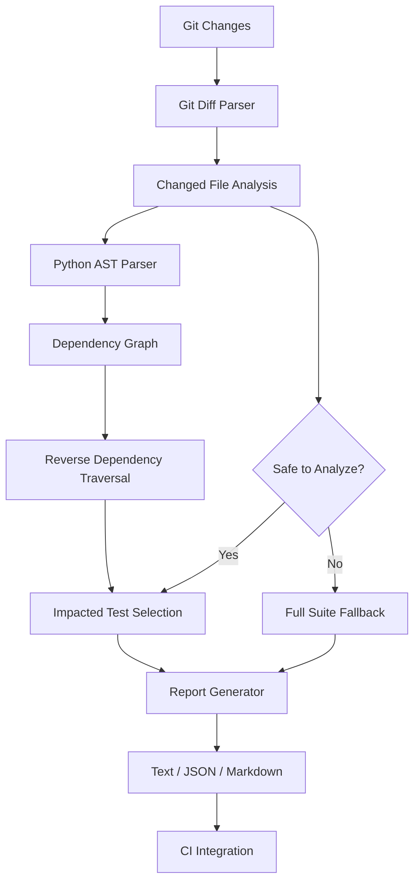

# Smart Test Impact Analyzer

[](https://github.com/chaitasipatel25/smart-test-impact-analyzer/actions/workflows/test.yml)

A dependency-aware test selection engine that analyzes Git changes to identify impacted tests, reduce unnecessary CI execution, and safely fall back to the full test suite when test selection is uncertain.

## The Problem

Running an entire test suite for every code change can increase CI execution time and consume unnecessary compute resources.

However, selecting only a subset of tests introduces a risk: incomplete dependency analysis can miss regressions.

Smart Test Impact Analyzer addresses this trade-off by analyzing Python dependencies and selecting tests that are directly or transitively affected by code changes.

When it cannot confidently identify impacted tests, it recommends running the full suite.

## Key Features

- **Git-aware change detection:** Identifies added, modified, deleted, renamed, and copied files.
- **Static dependency analysis:** Builds a Python module dependency graph using the AST parser.
- **Transitive impact analysis:** Finds tests affected through multiple dependency levels.
- **Direct test selection:** Includes tests that have changed themselves.
- **Conservative fallback:** Recommends the full suite for uncertain or unsupported changes.
- **Multiple report formats:** Generates terminal, JSON, and Markdown reports.
- **CI integration:** Runs in GitHub Actions and uploads test impact reports.
- **No runtime dependencies:** Uses Python standard library functionality.

## Architecture



## How It Works

1. Retrieves changed files from Git using base and head references.
2. Identifies relevant Python modules and test files.
3. Parses Python source files into ASTs.
4. Builds a dependency graph based on recognized imports.
5. Traverses the reverse dependency graph to identify affected modules.
6. Selects tests that directly or transitively depend on changed modules.
7. Uses a full-suite fallback when analysis is incomplete or uncertain.
8. Generates a report with selected tests, reasons, and selection metrics.

## Installation

Requires Python 3.11 or later.

```bash
git clone https://github.com/chaitasipatel25/smart-test-impact-analyzer.git
cd smart-test-impact-analyzer

python -m venv .venv
source .venv/bin/activate

pip install -e ".[dev]"
```

## Usage

Compare your current commit against the main branch:

```bash
test-impact --base main
```

Specify a repository:

```bash
test-impact --repo . --base main --head HEAD
```

Generate JSON:

```bash
test-impact --base main --format json
```

Generate Markdown:

```bash
test-impact --base main --format markdown
```

Write a report to a file:

```bash
test-impact \
  --base main \
  --format markdown \
  --output test-impact-report.md
```

The analyzer compares Git references and therefore analyzes committed changes, not uncommitted working-tree changes.

## Example

### Targeted test selection

Suppose a change is made to:

`src/payments/calculator.py`

The dependency graph identifies that both the calculator and service tests are affected.

Run:

```bash
test-impact --base main --head HEAD --format text
```

Representative output:

```text
Smart Test Impact Analyzer
==================================================

Selection mode: TARGETED
Changed files: 1
Selected tests: 2 / 2
Selection ratio: 100.0%

Selected Tests
--------------------------------------------------

tests/test_calculator.py
  Reason: Depends directly or transitively on src/payments/calculator.py

tests/test_service.py
  Reason: Depends directly or transitively on src/payments/calculator.py
```

### Conservative full-suite fallback

If a deleted file or test configuration change is detected, the analyzer recommends running the complete test suite rather than attempting a potentially incomplete selection.

For example, changing `pyproject.toml` triggers full-suite mode:

```text
Selection mode: FULL_SUITE
Changed files: 1
Selected tests: 2 / 2

Fallback reason:
Test configuration changed: pyproject.toml
```

These are representative examples of the expected report behavior, not captured terminal output.

## Safety Strategy

Test selection should optimize CI execution without silently compromising test coverage.

The analyzer recommends the full suite when it encounters situations such as:

- Deleted, renamed, or copied files.
- Test configuration or shared fixture changes.
- CI workflow changes.
- Unsupported non-Python changes.
- Invalid or unreadable Python source.
- Changed modules that cannot be mapped to the dependency graph.
- No confidently identifiable impacted tests.

This is intentionally conservative.

## CI Integration

The included GitHub Actions workflow:

1. Installs the project.
2. Runs the complete unit and integration test suite.
3. Runs test impact analysis for pull requests.
4. Uploads the Markdown report as a workflow artifact.

The initial integration keeps full-suite execution enabled while validating the accuracy of test selection.

## Design Decisions

| Decision | Rationale |
|---|---|
| Static AST analysis | Avoids executing application code during dependency discovery |
| Reverse dependency graph | Efficiently finds modules affected by a changed dependency |
| Conservative fallback | Prioritizes test coverage over aggressive optimization |
| Multiple output formats | Supports developers, CI systems, and future integrations |
| Advisory CI integration | Allows selection accuracy to be evaluated before skipping tests |

## Current Limitations

- Python dependency analysis only.
- Dynamic imports and runtime-generated dependencies are not resolved.
- Import relationships are inferred statically and may not represent every runtime dependency.
- Test discovery currently follows pytest-style Python filename conventions.
- Framework-specific fixture and plugin behavior is not fully modeled.
- Uncommitted working-tree changes are not included in Git comparisons.

## Running Tests

```bash
pytest -v
```

## Future Improvements

- Test selection for additional languages.
- Better handling of pytest fixtures and shared test dependencies.
- Configuration-driven test discovery.
- Historical test execution data and test-selection accuracy metrics.
- CI feedback loops to measure missed dependencies and selection quality.
- Integration with GitHub pull request checks.
